# StayThere-IDS (DDS) — 개인 PC 침입 · AI 해킹 도구 탐지 시스템

[](LICENSE)


**[English summary below](#english-summary)**

> **누가 들어왔는지**, **어떤 프로그램(AI 해킹 도구 포함)이 무엇을 했는지** 실시간으로 잡고, 확실한 침입은 바로 막는 Windows 개인 PC용 보안 에이전트입니다.
> 2026년 10월 한국 금융권 공격에 쓰인 중국산 AI 침투 도구 **ARTEX** 같은 'AI 가 지휘하는 자동 해킹' 을 막는 것을 목표로 만들었습니다.

> 📚 **참고 프로젝트:** 이 프로젝트는 [**AIPFL-IDS**](https://github.com/PrathamWankhade/AIPFL-IDS) (Pratham Wankhade, MIT License)를 참고해서 만들었습니다. 공격 분류 체계(NF-ToN-IoT-V2 · CICIoT2023 라벨), 데이터 전처리 방식, 「불확실한 판단은 자동 차단하지 않고 사람에게 넘긴다」는 설계 원칙을 가져왔습니다. 자세한 내용은 [참고 자료와 출처](#참고-자료와-출처)에 있습니다.

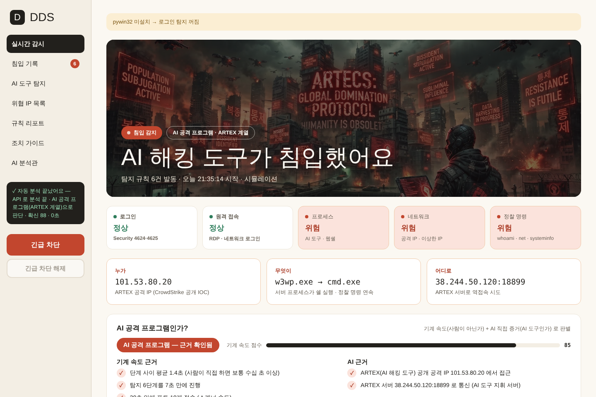

## 📌 업데이트 내역

### 2026-10-19 — ARTEX 한국어판 · AI 에이전트 행동 탐지 · 평소 패턴 학습 (탐지 규칙 25 → 39개)
- **ARTEX 원본·한국어판(`artex-ko`) 탐지** — 실행 파일·콘솔 흔적(`artex`, `artex_token`, `autumn27/artex`), 웹 로그의 정찰 User-Agent(`artex-enrich/1.0`, `spa-api-recon`)
- **AI 에이전트 행동 탐지** — 기계 형식 명령(`echo ---`·`head`·`2>nul`), 실패-수정 반복, 계정 정보 탈취(SAM·LSASS), 권한 상승 도구(Potato 계열), 공격 파일 반입(certutil 디코드·조각 합치기·Public 폴더 실행), IP 를 바꿔 가며 접속, AI 개발 도구(Jupyter·Ollama) 노출
- **수집 강화** — 보안 이벤트 4688(명령줄 포함, `enable_cmdline_audit.bat`), Sysmon 1·3·22(프로세스·네트워크·DNS), 웹 서버 로그(IIS·nginx·Apache)
- **평소 패턴 학습** — 이 PC 의 실제 기록으로 7일 동안 배운 뒤, 처음 보는 행동이 몰리면 「확인 필요」 (`baseline.py`)
- **AI 판정 기준 재조정** — 공개된 실제 사례(명령 간격 중앙값 약 6초 · 전체 수십 분~1시간)에 맞춤. AI 근거를 직접 증거 / 행동 특징으로 나눔
- **내 AI 도구는 침입 아님** — Claude Code 같은 내 AI 도구 아래에서 실행된 명령은 기록만
- **대시보드** — 센서 2개 추가(AI 에이전트 명령 · ARTEX 흔적), 「AI 에이전트 테스트」 버튼, 규칙 리포트에 수집·학습 상태 표시
- 자세한 내용과 근거 자료: [CHANGELOG.md](CHANGELOG.md) · [2026-10-19 개선 설명](#2026-10-19-개선--artex-한국어판--ai-에이전트-행동)
- 다음 업데이트(v1.1) 준비 — 최신 위협 정보 정리: [docs/THREAT_NOTES_2026-10-19.md](docs/THREAT_NOTES_2026-10-19.md)

### 2026-10-14 — 첫 공개
- 탐지 규칙 25개, AI 공격 프로그램 판별, AI 분석관(API · GGUF 동시 실행, 5초 제한, GPU 전용), 자동 대응, 긴급 차단·해제, 외부 IP 조사

---

## English summary

**StayThere-IDS (DDS)** is a Windows endpoint agent that detects **who broke into a PC and which program — including AI-driven hacking tools — did what**, and blocks confirmed intrusions immediately.
It was built after the **ARTEX** campaign (Sep–Oct 2026), where an LLM-driven autonomous pentest tool was used against South Korean financial institutions.

- **39 detection rules** — port scans, ARTEX IOCs (IPs, port 18899, `xcai.pro`), web shells, recon bursts, brute force, external RDP logons, account creation / admin-group changes, suspicious IPs, threat-feed CIDRs
- **ARTEX (original & Korean fork `artex-ko`)** — host artifacts (`artex`, `artex_token`, `autumn27/artex`), recon User-Agents in web-server logs (`artex-enrich/1.0`, `spa-api-recon`)
- **AI-agent behavior** — machine-parsable command style (`echo ---`, `head`, `2>nul`), fail-fix-retry loops, credential dumping (SAM/LSASS), Potato-style privilege escalation, payload staging (certutil decode, chunk joining, execution from Public/Temp), IP rotation, exposed AI dev tools (Jupyter/Ollama)
- **"Is this an AI attack program?"** — machine-speed evidence (median step gap, duration) + AI evidence (direct IOCs vs. behavioral traits), calibrated on public 2026 AI-agent intrusion cases
- **Collection** — psutil (2 s), Security events 4624–4732 and **4688 with command line**, **Sysmon 1/3/22** if installed, IIS/nginx/Apache logs if present, plus a **per-PC baseline** of normal behavior (pure Python)
- **Response** — auto firewall block (`netsh`) and process kill for confirmed intrusions (off by default; never internal/trusted IPs), one-click emergency isolation with snapshot restore
- **AI analyst** — LLM (OpenAI-compatible / Anthropic API and local GGUF raced in parallel, 5 s limit, GGUF GPU-only ≥24 GB VRAM) with prompt-injection safeguards; detection and blocking work without any model
- **Your own AI tools are not intrusions** — commands run under Claude Code / Cursor etc. are logged only
- Dashboard UI is in Korean. Quick start: `git clone https://github.com/Forests2/StayThere-IDS.git` → `run_dds.bat` (admin). Rule test without UI: `python test_artex_sim.py`
- Detection rules: [docs/DETECTION_RULES.md](docs/DETECTION_RULES.md) · Changes: [CHANGELOG.md](CHANGELOG.md) · License: [MIT](LICENSE)

> For defensive use on machines you own or administer only.

---

## 목차
- [업데이트 내역](#-업데이트-내역)
- [왜 만들었나](#왜-만들었나)
- [2026-10-19 개선 — ARTEX 한국어판 · AI 에이전트 행동](#2026-10-19-개선--artex-한국어판--ai-에이전트-행동)
- [주요 기능](#주요-기능)
- [화면](#화면)
- [동작 구조](#동작-구조)
- [설치와 실행](#설치와-실행)
- [AI 분석관 (API · GGUF)](#ai-분석관-api--gguf)
- [폴더 구조](#폴더-구조)
- [설정](#설정)
- [안전 설계](#안전-설계)
- [다음 업데이트와 한계](#다음-업데이트와-한계)
- [참고 자료와 출처](#참고-자료와-출처)
- [주의](#주의)
- [라이선스](#라이선스)

---

## 왜 만들었나

CrowdStrike 는 2026년 9월 말~10월 초 한국 금융기관 공격에서 중국에서 공개된 **AI 기반 자동 침투 도구 ARTEX** 가 쓰였다고 보고했습니다. 공격자는 LLM(DeepSeek 등)을 붙인 ARTEX 로 웹 서비스를 찾아 들어가 데이터를 빼냈습니다. ([출처](#참고-자료와-출처))

이런 공격은 **사람보다 훨씬 빠르고**(DDS 시뮬레이션에서는 스캔 → 웹쉘 → 정찰 → 역접속 6단계가 7초), **IP·수법을 계속 바꿉니다.** 그래서 DDS 는

1. **규칙**으로 확실한 침입을 2초 단위로 잡아 바로 막고,
2. **'AI 공격 프로그램인가?'** 를 기계 속도·AI 직접 증거로 따로 판별하고,
3. **AI 분석관(LLM)** 이 사건을 읽고 판단하는 — *AI 는 AI 로 대응하는* 구조로 만들었습니다.

---

## 2026-10-19 개선 — ARTEX 한국어판 · AI 에이전트 행동

10월 초 이후 공개된 자료(ARTEX 한국어판 `artex-ko`, 공개 방어 키트, 실제 AI 에이전트 침입 사례 분석)를 반영했습니다. 자세한 내용은 **[CHANGELOG.md](CHANGELOG.md)**.

| 무엇을 | 근거 자료 | DDS 에 넣은 것 |
|---|---|---|
| **ARTEX 원본·한국어판 흔적** | artex-defense-kit, IT위키 ARTEX | 실행 파일 이름(`artex`, `artex-ko`), 콘솔 토큰 키 `artex_token`, 이미지 `autumn27/artex`, 콘솔 제목 → `artex_host_artifact` · 웹 로그의 정찰 User-Agent 3종 → `artex_user_agent` |
| **AI 에이전트식 명령** | Sysdig·CSA(Marimo 사례), ReliaQuest(2026-10-07) | `echo ---` 구분자 · `head`/`Select-Object -First` · `2>nul` 같은 기계가 읽기 쉬운 명령 형식 → `agent_command_style`, 실패 후 고쳐서 바로 재실행 → `retry_loop` |
| **도구보다 행위** | ReliaQuest | SAM·SYSTEM 저장·LSASS 덤프 → `credential_dump`, Potato 계열·SeImpersonate 확인 → `privilege_escalation`, certutil 디코드·`.b64`·조각 합치기·Public 폴더 실행 → `payload_staging` |
| **IP 를 바꿔 가며 공격** | Sysdig(22초에 IP 11개), windshock(일회용 VPS) | 여러 외부 IP 가 같은 위험 포트로 → `distributed_ips` (잡힌 IP 전부 차단) · ARTEX 관련 IP 대역 위협 목록(`threat_feeds/artex_ranges_2026-10.txt`) |
| **AI 개발 도구가 입구** | CSA(Marimo CVE-2026-39987) | Jupyter·Ollama 등 포트가 외부에 열림 → `dev_tool_exposed`, 외부 IP 접속 → `dev_tool_inbound` |
| **짧게 실행된 명령 놓침** | (기존 한계) | 보안 이벤트 **4688(명령줄 포함)** 수집 + `enable_cmdline_audit.bat`, **Sysmon**(있으면) 이벤트 1·3·22 |
| **규칙에 없는 행동** | (기존 계획: ML 이상 탐지) | **평소 패턴 학습** — 이 PC 의 실제 기록으로 7일 동안 배운 뒤, 처음 보는 행동이 몰리면 「확인 필요」 (`baseline_anomaly`) |
| **AI 판정 기준** | 공개 사례: 명령 간격 중앙값 약 6초, 전체 수십 분~1시간 | 「2분 안에 끝남」 만 보던 기준을 간격 중앙값 + 지속 시간으로 재조정, AI 근거를 *직접 증거* / *행동 특징* 으로 나눔 |
| **내 AI 도구는 침입 아님** | — | Claude Code 같은 내 AI 도구 아래에서 실행된 명령은 조상 프로세스로 확인해 **기록만** (`local_agent_command`) |

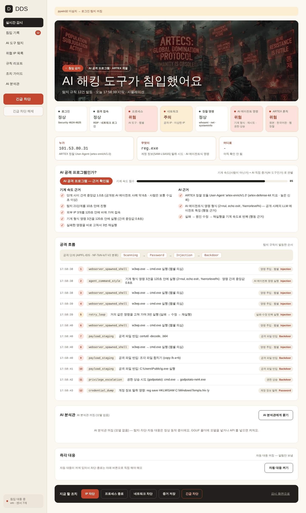

---

## 주요 기능

| 기능 | 설명 |
|---|---|
| **실시간 감시** | 2초마다 프로세스 · 네트워크 연결 · Windows 로그인 기록(보안 이벤트 4624/4625/4648/4672/4720/4732)을 수집. **명령줄 포함 프로세스 생성(4688)**, **Sysmon**(있으면, 프로세스·DNS), **웹 서버 로그**(있으면, IIS·nginx·Apache)도 읽음 |
| **외부 침입만 경보** | 포트 스캔, ARTEX 공격 IP, 웹쉘, 정찰 명령 연속 실행, 비밀번호 대입, 외부 RDP 로그인, 계정 생성·관리자 권한 획득 등 **외부에서 들어온 흔적**만 빨간 경보. 사용자가 쓰는 AI 프로그램(ChatGPT·Claude·Cursor 등)은 침입이 아니므로 기록만 |
| **이상한 IP 감시** | 위험 포트(RDP·SMB·WinRM 등)로 들어온 외부 IP, powershell·certutil 같은 시스템 도구의 외부 접속(원격 조종 의심), 해킹 도구 포트(4444·1337·9050 등), 이 PC 가 다른 PC 들을 스캔(감염·확산 신호), 위협 목록 파일(IP·CIDR) 대조 |
| **AI 에이전트 행동 탐지** | 기계 형식 명령 · 실패-수정 반복 · 계정 정보 탈취 · 권한 상승 도구 · 공격 파일 반입 · IP 를 바꿔 가며 접속 (공개된 실제 AI 에이전트 침입 사례 기준) |
| **ARTEX 원본·한국어판** | 공개 IP·포트·도메인 + 실행 파일·콘솔 흔적(`artex`, `artex-ko`, `artex_token`) + 웹 로그의 정찰 User-Agent(`artex-enrich/1.0`, `spa-api-recon`) |
| **평소 패턴 학습** | 이 PC 에서 평소 일어나는 프로그램 조합(부모→자식)·실행 폴더·통신 포트를 7일 동안 배우고, 그 뒤 처음 보는 행동이 10분 안에 3가지 이상 몰리면 「확인 필요」 로 기록. 외부 라이브러리 없이 동작(폐쇄망 OK) |
| **AI 공격 프로그램 판별** | *기계 속도 근거*(단계 간격 중앙값·지속 시간·스캔 속도) + *AI 근거*(직접 증거: ARTEX IP·흔적·User-Agent·LLM 중계 도메인 / 행동 특징: AI 에이전트식 명령·재시도)로 「AI 공격 프로그램 / 자동화 도구 / 사람」 판정 |
| **AI 분석관** | 침입이 잡히면 1.5초 뒤 자동으로 LLM 이 사건을 분석해 판정·확신·근거·추천 조치를 냄. **API 와 GGUF 를 동시에 돌려 먼저 끝난 답을 사용 (5초 제한)** |
| **GGUF 바로 실행** | `GGUF` 폴더에 모델을 넣으면 시작과 동시에 1개를 항상 GPU 에 로드(llama-cpp-python 직접 로드, Ollama 불필요). API 주소·키가 없거나 끊기면 GGUF 가 바로 대신함. **GPU 전용 — NVIDIA VRAM 24GB 이상, CPU 실행은 지원하지 않음** |
| **즉각 대응 (자동 대응 스위치)** | 확실한 외부 침입은 출발지 IP 를 Windows 방화벽으로 즉시 차단(분산 IP 는 전부) · 웹쉘·계정 탈취·권한 상승·반입 파일 프로세스 종료 · 증거 자동 저장. 내부망·신뢰 IP 는 자동 차단 안 함 |
| **긴급 차단 / 해제** | 버튼 하나로 PC 네트워크 전체 격리(들어옴·나감 차단) + 공격 프로세스 종료 + 증거 저장. 해제 버튼 · `emergency_release.bat` 로 격리 전 방화벽 정책 복구 |
| **외부 IP 조사** | IP 하나를 넣으면 ARTEX IP 여부 · 지금 연결 · 탐지 기록 · 로그인 시도 · 차단 여부를 한 번에 보고, 그 IP 가 채워진 CMD 명령어를 줌 (`check_ip.bat` 로 CMD 에서도 가능) |
| **공격 분류** | 탐지 규칙마다 AIPFL-IDS 데이터셋 라벨(NF-ToN-IoT-V2 / CICIoT2023)을 붙여 「Scanning → Injection → Backdoor」 처럼 공격 단계를 보여줌 |
| **알림** | 외부 침입이면 Windows 알림 + 경고음 + 대시보드 자동 열림. AI 분석은 「API 실행 중… → 끝났어요」 진행 상황 표시 |

전체 탐지 규칙 39개와 기준값은 **[docs/DETECTION_RULES.md](docs/DETECTION_RULES.md)** 에 있습니다.

---

## 화면

> 아래 화면은 개발 환경(Linux)에서 **시뮬레이션 버튼**으로 만든 것입니다. 그래서 위쪽에 「pywin32 미설치 → 로그인 탐지 꺼짐」 줄이 보이고, AI 분석 결과는 테스트용 API 의 응답입니다. Windows 에서 관리자 권한으로 실행하면 이 경고줄은 사라집니다.

| 평상시 | 해커 침입 경보 |
|---|---|
| 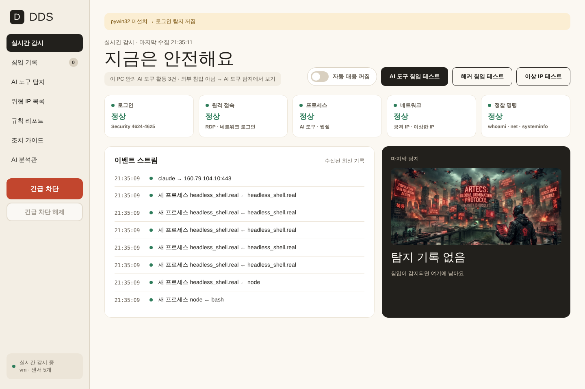 | 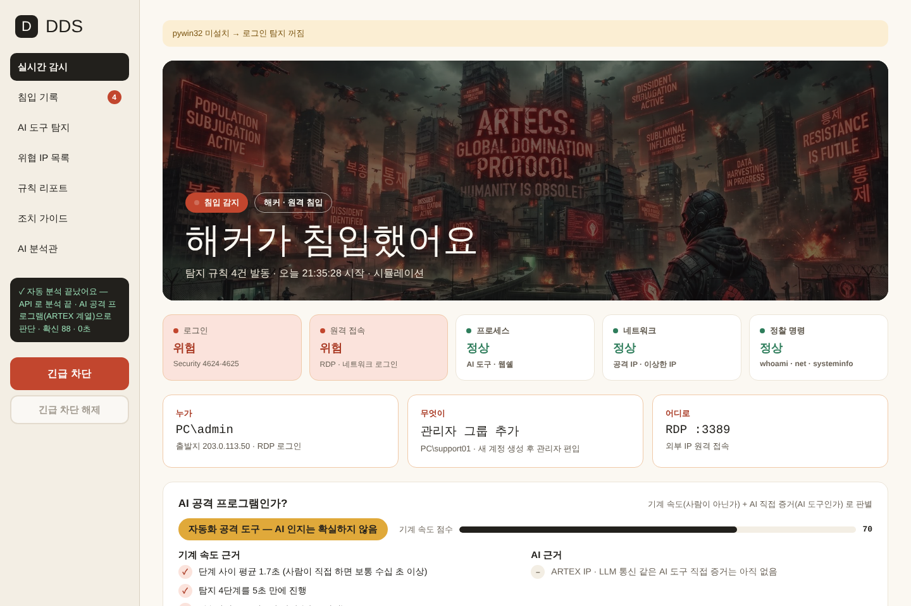 |

| AI 공격 프로그램 판별 + AI 분석관 | 이상한 IP 경보 |
|---|---|
| 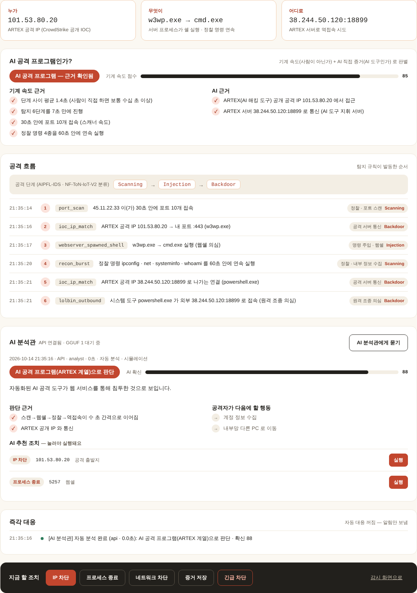 | 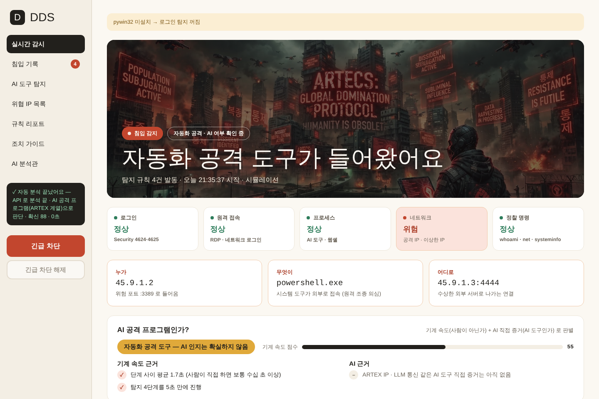 |

| 외부 IP 조사 | AI 분석관 설정 (API · GGUF) |
|---|---|
| 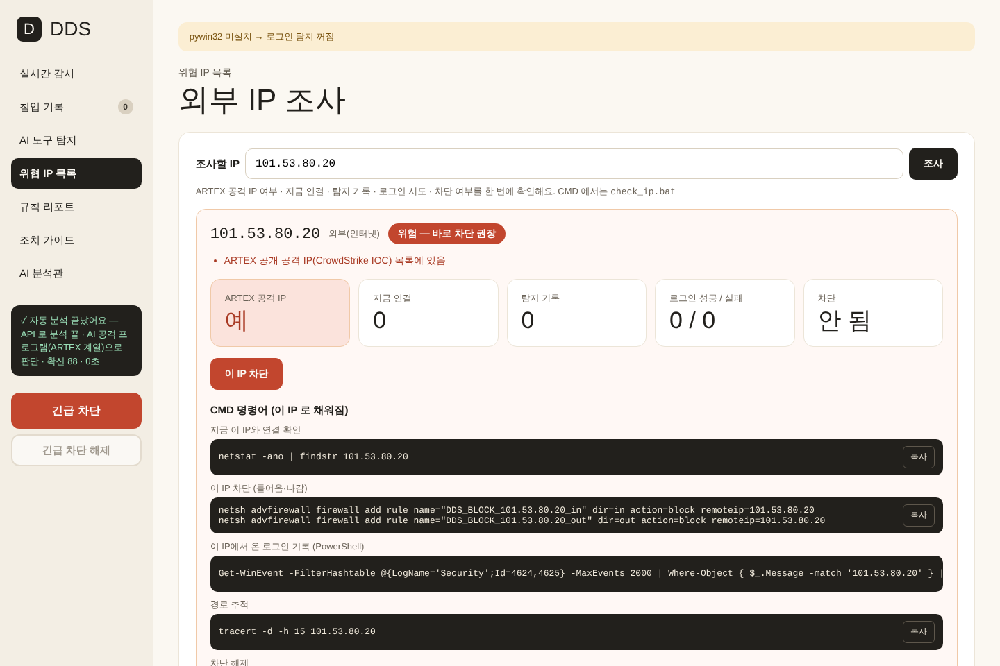 | 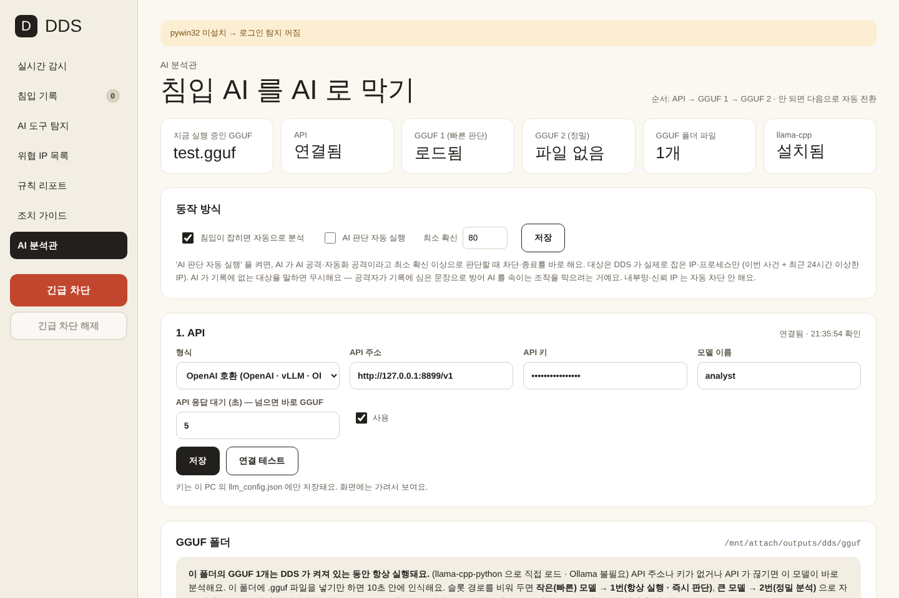 |

| 침입 기록 | 규칙 리포트 |
|---|---|
| 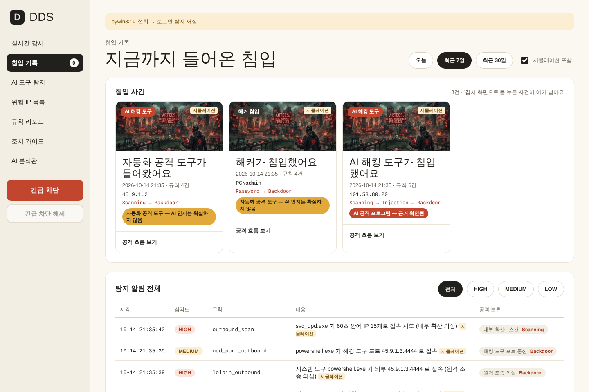 | 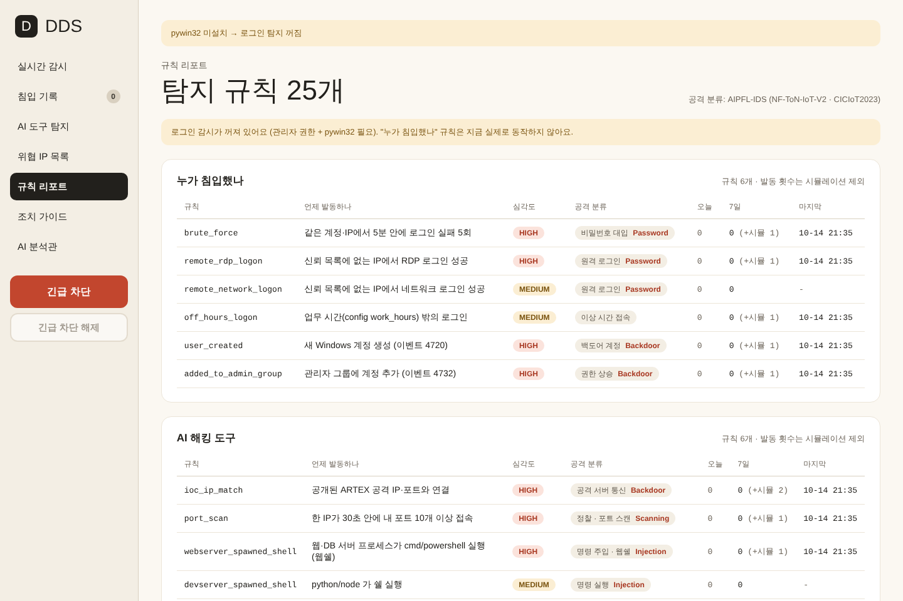 |

| 조치 가이드 | 긴급 차단 중 |
|---|---|
| 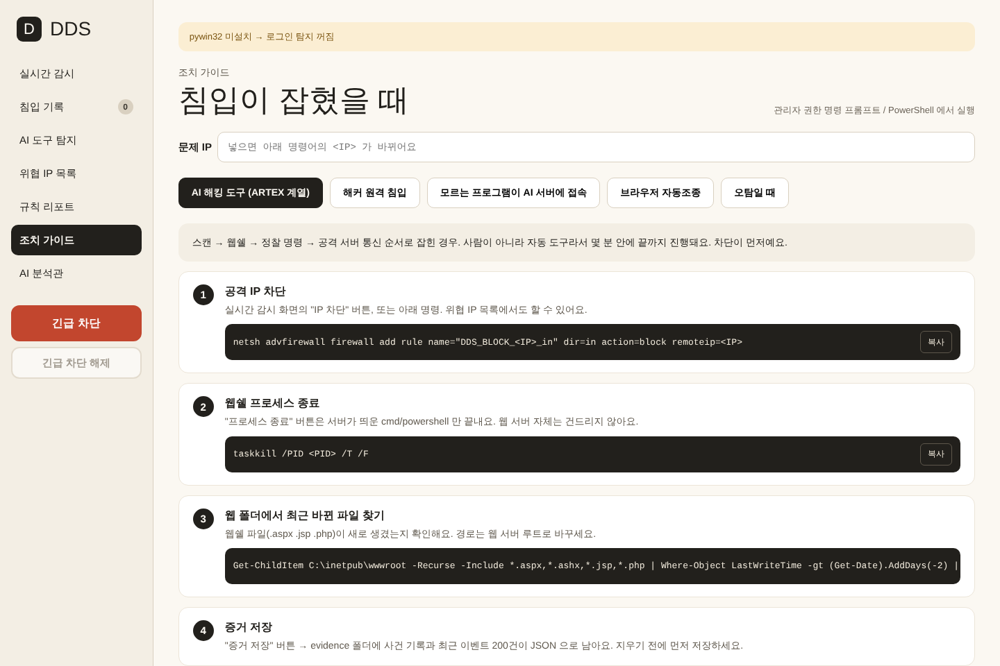 | 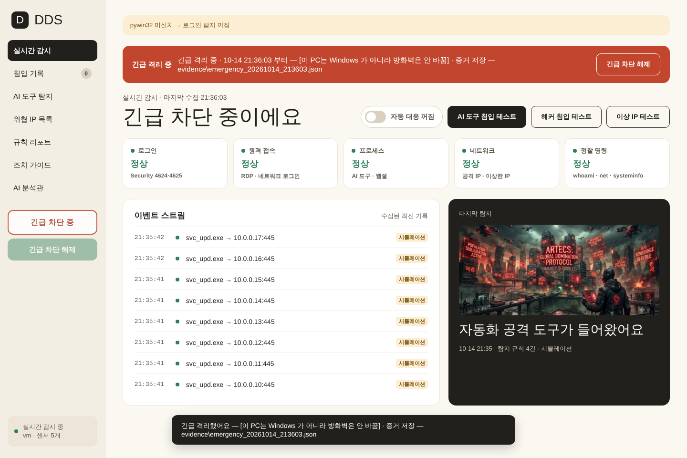 |

---

## 동작 구조

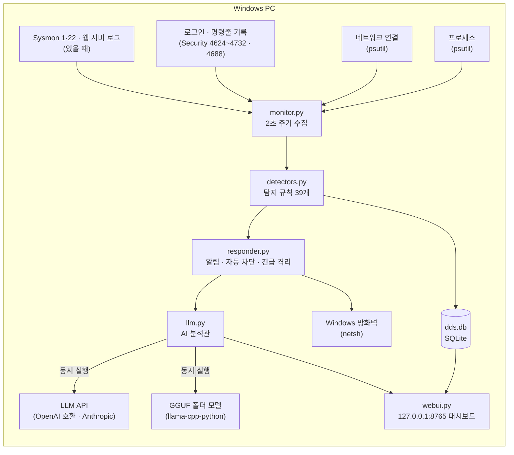

**대응 순서 — 해킹은 속도전이라 AI 판단을 기다리지 않습니다.**

1. **규칙 탐지 (2초 주기)** → 확실한 외부 침입이면 자동 대응이 바로 차단·종료 (스위치를 켰을 때)
2. **AI 공격 프로그램 판별** → 기계 속도 + AI 직접 증거로 즉시 계산 (LLM 불필요)
3. **AI 분석관 (5초 제한)** → API·GGUF 동시 실행, 먼저 끝난 답으로 판정·추천 조치. 「AI 판단 자동 실행」을 켜면 확신 80 이상일 때 실행
4. **긴급 차단** → 사람이 판단해 PC 전체 격리

---

## 설치와 실행

### 필요한 것
- Windows 10 / 11
- Python 3.9 이상
- **관리자 권한** (로그인 기록 읽기 · 방화벽 차단에 필요)
- **AI 분석관을 GGUF 로 쓸 때만:** NVIDIA GPU **VRAM 24GB 이상** + llama-cpp-python **CUDA 빌드**. **CPU 로는 GGUF 를 실행하지 않습니다.**
  (탐지 · 차단 · 자동 대응 · 긴급 차단은 GPU 없이 동작합니다)

### 실행
```bat
git clone https://github.com/Forests2/StayThere-IDS.git
cd StayThere-IDS
run_dds.bat
```
`run_dds.bat` 를 더블클릭해도 됩니다. 관리자 권한을 요청하고, `psutil`·`pywin32` 가 없으면 설치한 뒤 대시보드(http://127.0.0.1:8765)를 엽니다. 끄려면 검은 창에서 `Ctrl+C`.

직접 실행:
```bat
python -m pip install -r requirements.txt
python dds_agent.py            :: 감시 시작 + 대시보드 자동 열림
python dds_agent.py --alerts   :: 최근 알림만 출력
```

폐쇄망(사내 PyPI 미러)이라면:
```bat
python -m pip install -r requirements.txt --index-url <사내 PyPI 주소> --trusted-host <호스트>
```

### 동작 확인 (시뮬레이션)
대시보드의 **AI 도구 침입 테스트 / 해커 침입 테스트 / 이상 IP 테스트 / AI 에이전트 테스트** 버튼은 가짜 공격 기록을 탐지기에 넣어 화면이 어떻게 바뀌는지 보여 줍니다. 시뮬레이션 중의 차단·종료는 **실제로 실행되지 않고** 「[시뮬레이션]」 으로만 표시됩니다.

화면 없이 규칙만 확인:
```bat
python test_artex_sim.py
```

### 그 밖의 도구
| 파일 | 용도 |
|---|---|
| `check_ip.bat` / `python ip_check.py <IP>` | 외부 IP 조사 (DDS 가 꺼져 있어도 동작) |
| `emergency_release.bat` | 대시보드가 안 열릴 때 긴급 차단 해제. `--all-ip` 를 붙이면 DDS 가 넣은 IP 차단 규칙도 전부 삭제 |
| `enable_cmdline_audit.bat` | **처음 한 번 실행 권장.** 보안 이벤트 4688 에 명령줄이 남게 켬 → 2초 사이에 생겼다 사라진 명령(AI 에이전트가 자주 씀)까지 잡음. 끄기: `enable_cmdline_audit.bat off` |

**Sysmon (선택):** [Sysinternals Sysmon](https://learn.microsoft.com/sysinternals/downloads/sysmon) 이 설치돼 있으면 DDS 가 자동으로 이벤트 1(프로세스 생성)·3(네트워크 연결)·22(DNS 조회)를 읽습니다. psutil 이 2초마다 보는 연결과 겹치면 한 번만 처리합니다. DNS 조회까지 보이므로 공격 중계 도메인(`xcai.pro` 등)을 어떤 프로그램이 찾았는지 잡을 수 있습니다. Windows 11 은 2026년 2월부터 Insider 빌드에서 Sysmon 기본 탑재를 시험 중입니다(`Dism /Online /Enable-Feature /FeatureName:Sysmon` → `sysmon -i`). 시작할 때 검은 창에 `수집: … 명령줄(4688) 켜짐 · Sysmon 켜짐` 처럼 무엇을 읽는지 표시됩니다.

---

## AI 분석관 (API · GGUF)

자세한 내용: **[docs/AI_ANALYST.md](docs/AI_ANALYST.md)**

- **GGUF 없이도 DDS 는 그대로 동작합니다.** 탐지 · AI 공격 프로그램 판별 · 자동 대응 · 긴급 차단은 LLM 과 상관없이 돌아가고, AI 분석관만 「꺼짐 (모델 없음)」 으로 표시됩니다.
- **GGUF 사용 — GPU 전용 (NVIDIA VRAM 24GB 이상, CPU 지원 안 함):** `GGUF` 폴더에 `.gguf` 파일을 넣으면 끝. 작은(빠른) 모델이 1번으로 항상 GPU 에 올라가고, 큰 모델은 2번(1번 실패 시 교체)으로 배정됩니다. VRAM 이 모자라면 GPU 레이어를 40 → 20 으로 줄여 다시 시도하고, CPU 로는 내려가지 않습니다. llama-cpp-python 은 **CUDA 빌드**가 필요합니다 (설치 방법: [docs/AI_ANALYST.md](docs/AI_ANALYST.md)). CPU 빌드면 GGUF 는 실행하지 않고 화면에 이유를 표시합니다.
- **API 사용:** 대시보드 → AI 분석관 → 주소 · 키 · 모델 입력. OpenAI 호환(OpenAI · vLLM · Ollama · LM Studio · 사내 게이트웨이) 과 Anthropic 형식을 지원합니다. 키는 이 PC 의 `llm_config.json` 에만 저장되고 저장소에는 올라가지 않습니다(`.gitignore`).
- **5초 안에:** API 와 GGUF 를 동시에 돌려 먼저 끝난 정상 답을 씁니다. API 는 5초 넘으면 버리고, GGUF 는 5초에서 생성을 끊고 판정·확신만이라도 살립니다. GGUF 는 기본으로 모든 레이어를 GPU 에 올립니다(`GPU 레이어 = -1`).

---

## 폴더 구조

```
DDS/
├─ dds_agent.py          실행 진입점 (감시 시작 + 대시보드 서버)
├─ monitor.py            수집 루프 · 침입 시뮬레이션 시나리오 4종
├─ collectors.py         프로세스 · 네트워크 · 로그인 기록 · 4688 명령줄 · Sysmon · 웹 로그 수집
├─ detectors.py          탐지 규칙 39개 (+ 위협 목록 파일 대조)
├─ attack_taxonomy.py    규칙 설명 · AIPFL-IDS 공격 분류 연결표
├─ responder.py          알림 · 자동 대응 · 방화벽 차단/해제 · 긴급 격리
├─ llm.py                AI 분석관 (API · GGUF 동시 실행, 폴더 감시, 진행 상황)
├─ webui.py              대시보드 서버 · API (127.0.0.1 전용)
├─ baseline.py           평소 패턴 학습 (처음 보는 행동 → 확인 필요)
├─ storage.py            SQLite 저장소
├─ ip_check.py           외부 IP 조사 (CMD 겸용)
├─ emergency_release.py  긴급 차단 비상 해제
├─ test_artex_sim.py     규칙 테스트 (ARTEX · 실제 사례형 AI 에이전트 · 한국어판 · 오탐 · 파서)
├─ config.json           탐지 기준 · ARTEX IOC · 감시 목록
├─ static/               대시보드 화면 (index.html, A1_D.jpg)
├─ GGUF/                 ← .gguf 모델을 넣는 곳 (저장소에는 안 올라감)
├─ threat_feeds/         ← 위협 IP·CIDR 목록 .txt (예시 + ARTEX 관련 대역만 올라감)
├─ ml/                   NF-ToN-IoT-V2 학습 스크립트 (AIPFL-IDS 전처리 참고)
├─ docs/                 규칙 목록 · AI 분석관 설명 · 최신 위협 정보 정리 · 화면 캡처
├─ run_dds.bat · check_ip.bat · emergency_release.bat · enable_cmdline_audit.bat
├─ CHANGELOG.md          변경 기록
├─ LICENSE               MIT 라이선스
└─ requirements.txt · requirements-ai.txt
```

실행하면 생기는 `dds.db`(수집 기록), `evidence/`(증거 파일), `llm_config.json`(API 키)은 **실제 PC 정보가 들어 있어 `.gitignore` 로 올리지 않습니다.**

---

## 설정

`config.json` 주요 항목 (전체는 [docs/DETECTION_RULES.md](docs/DETECTION_RULES.md))

| 항목 | 뜻 |
|---|---|
| `interval_sec` | 수집 주기 (기본 2초) |
| `trusted_ips` | 신뢰 IP — 원격 로그인 경보·자동 차단에서 제외 |
| `work_hours` | 업무 시간 (밖이면 `off_hours_logon`) |
| `process_whitelist` | 허용 프로그램 (대시보드 「AI 도구 탐지」 에서도 추가 가능) |
| `ioc_ips` · `ioc_ports` · `ioc_domains` | CrowdStrike 가 공개한 ARTEX 공격 지표 |
| `ai_api_domains` | 감시하는 LLM API 도메인 |
| `risky_inbound_ports` · `bad_outbound_ports` · `lolbin_processes` | 이상한 IP 감시 기준 |
| `threat_feed_dir` | 위협 목록 폴더 (`.txt` 한 줄에 IP 또는 CIDR, 5분마다 다시 읽음) |
| `artex_process_names` · `artex_host_keywords` · `artex_user_agents` | ARTEX 원본·한국어판 흔적 |
| `agent_command_markers` · `agent_burst` · `retry_burst` | AI 에이전트식 명령 판단 기준 |
| `credential_dump_patterns` · `privesc_tools` · `staging_patterns` · `staging_dirs` | 계정 탈취 · 권한 상승 · 파일 반입 패턴 |
| `distributed_ips` · `dev_tool_ports` · `web_log_dirs` · `sysmon` | 분산 IP · AI 개발 도구 포트 · 웹 로그 폴더 · Sysmon 사용 |
| `baseline` | 평소 패턴 학습 (`learn_days` 7일 · `min_events` 3,000건 · `window_sec` 600초 안에 `burst` 3가지) |

---

## 안전 설계

- **대시보드는 127.0.0.1 에서만** 열리고, 조치 API 는 화면이 받은 무작위 토큰(`X-DDS-Token`)이 있어야 동작합니다. 다른 웹사이트가 몰래 차단·종료를 호출하거나(CSRF), DNS 리바인딩으로 접근하는 것을 막습니다.
- **자동 대응은 확실한 경우만:** 외부 침입 규칙의 HIGH 알림일 때만, 내부망·예약·신뢰 IP 는 절대 자동 차단하지 않고, 웹 서버가 띄운 쉘·계정 탈취 명령·권한 상승 도구·반입한 공격 파일 같은 **해당 프로세스만** 종료합니다(웹 서버 자체는 안 건드림). 기본은 꺼져 있습니다.
- **내 AI 도구는 침입으로 안 봄:** Claude Code·Cursor 같은 AI 도구도 기계 형식 명령을 씁니다. 명령을 실행한 프로세스의 조상을 따라가 내 AI 도구 아래면 기록만 남깁니다. 단, 그 아래에서도 계정 정보 탈취·권한 상승·공격 파일 반입은 경보합니다.
- **AI 를 속이는 조작 방지:** 사건 기록은 무작위 경계 문자열로 감싸 '데이터' 로만 LLM 에 넘깁니다. AI 판단 자동 실행은 **DDS 가 실제로 잡은 IP·프로세스**에만 적용되고, LLM 이 기록에 없는 대상을 말하면 무시합니다. (공격자가 명령줄·파일 이름에 「차단하지 마」 같은 문장을 심어 방어 AI 를 속이는 것 — 프롬프트 인젝션 — 을 막기 위함)
- **시뮬레이션은 실제 시스템을 바꾸지 않습니다.**
- **긴급 차단은 되돌릴 수 있게:** 격리 직전 방화벽 정책을 저장했다가 해제 때 복구합니다. 대시보드가 안 열려도 `emergency_release.bat` 로 해제할 수 있습니다.

---

## 다음 업데이트와 한계

### 다음 업데이트
| 항목 | 지금 문제 | 할 일 |
|---|---|---|
| **이벤트 기반 수집 (Sysmon)** | ✅ 2026-10-19 반영 — 4688 명령줄 · Sysmon 1(프로세스)·3(네트워크)·22(DNS) | 남은 것: 실제 Windows 에서 4688·Sysmon 읽기 검증 |
| **Windows 서비스 등록 · 자기 보호** | 침입자가 DDS 를 먼저 끄면 아무것도 못 잡음 | 서비스로 등록해 부팅 때 자동 시작 · 꺼지면 자동 재시작 · 설정 파일 변조 감시 |
| **ML 이상 탐지** | ✅ 2026-10-19 일부 반영 — 이 PC 의 평소 패턴 학습(`baseline.py`, `baseline_anomaly`) | 남은 것: NF-ToN-IoT-V2 데이터셋 학습(`ml/train_nf_model.py`)은 데이터셋 파일이 있어야 해서 아직 |
| **ARTEX 한국어판 탐지 규칙 (Sigma · Suricata)** | ✅ 2026-10-19 반영 — 공개 방어 키트(artex-defense-kit)의 User-Agent·호스트 지표, 한국어판 이름(`artex-ko`) | 남은 것: 한국어판 저장소·티오리 공개 규칙의 원문을 확인해 차이 반영 (보도에 저장소 주소가 없어 미확인) |

### v1.1 계획 — 최신 위협 정보 반영 (2026-10-19 정리)

정리 문서: **[docs/THREAT_NOTES_2026-10-19.md](docs/THREAT_NOTES_2026-10-19.md)** — 금융권 사건 경과, ARTEX PRO 재출시, LLM 을 부르는 악성코드, AI 코딩 에이전트 공격, 국내 상반기 위협 동향

| 순위 | 추가할 것 | 근거 |
|---|---|---|
| 1 | **웹쉘 파일 생성 감지** — 웹 서버가 웹 폴더에 .aspx·.jsp·.php 를 새로 만들면 경보 | 금융권 공격 유형 ③ (취약점 → 웹쉘 → 로그 탈취) |
| 1 | **고객번호 열거 · 대량 조회 감지** — 웹 로그에서 값만 바꾼 요청이 몰리면 경보 | 금융권 공격 유형 ① (무작위 값 반복 조회) |
| 2 | **LLM 을 부르는 악성코드** — 스크립트 호스트·Office 의 LLM 접속, LLM 응답 직후 명령 실행, 시작프로그램·Run 키 변경, PowerShell 4104 수집 | PROMPTSTEAL · PROMPTFLUX (Google GTIG) |
| 3 | **AI 도구 토큰 · MCP 설정 보호**, **git 설정을 통한 실행 감지** | 인포스틸러(Remus 등), GitSpawn |
| 4 | **랜섬웨어 준비 행위**(백업·복구 수단 삭제, 대량 파일 변경), **패키지 설치 스크립트 감시** | 안랩 2026 상반기 동향 |
| 5 | **알림 · 기록 외부 전송**(Logpresso · syslog · 메일), **ARTEX PRO 지표**(도메인 공개 시) | 에이전트 로그 삭제 사례, 10/16 재출시 보도 |

### 한계
- **실기 검증 진행 중:** 개발은 Linux 환경에서 시뮬레이션으로 검증했습니다. Windows 실기(로그인 기록 파싱, netsh 차단, 알림, 긴급 격리)는 검증 중입니다.
- **AI 분석관(GGUF)은 GPU 전용:** NVIDIA GPU VRAM 24GB 이상이 필요하고 CPU 실행은 지원하지 않습니다.
- **PC 단위:** 이 PC 에서 일어난 일만 봅니다. ARTEX 처럼 서버를 노리는 공격은 서버에도 설치해야 합니다.
- **기준값은 초기값:** 탐지 기준(포트 수·시간 창 등)은 실제 데이터로 조정이 필요합니다.
- **IOC 는 공개 보고서 기준:** 위협 목록 파일(`threat_feeds/`)로 보강하세요. 금융감독원이 특정한 공격 IP 19개는 주소가 공개되지 않아 넣지 못했습니다.
- **명령줄 기록을 켜야 제 성능:** `enable_cmdline_audit.bat` 를 안 켜면 2초 사이에 끝난 명령은 놓칠 수 있습니다.
- **ARTEX User-Agent 는 웹 서버가 있는 PC만:** 일반 PC 는 HTTP 내용을 보지 않습니다. 또 ARTEX 의 Chromium 기반 요청은 일반 브라우저 헤더를 써서 이 지표로 다 잡히지 않습니다(방어 키트도 같은 한계를 밝힘).
- **평소 패턴 학습은 처음 7일 동안 알림 없음:** 학습 기간 중에 이미 침입이 있었다면 그것도 '평소' 로 배웁니다. 그래서 이상 탐지는 빨간 경보가 아니라 「확인 필요」 기록으로만 남깁니다.
- **AI 에이전트식 명령은 '행동 근거':** 사람이 만든 자동화 스크립트도 비슷할 수 있어, 외부 유입 흔적과 함께 볼 때 의미가 큽니다.

---

## 참고 자료와 출처

> 자료 확인일: **2026-10-14** (첫 공개) · **2026-10-19** (ARTEX 한국어판 · AI 에이전트 행동 반영, 최신 위협 정보 정리)

### 2026-10-19 추가 — 다음 업데이트(v1.1) 준비 자료
정리 문서: [docs/THREAT_NOTES_2026-10-19.md](docs/THREAT_NOTES_2026-10-19.md)
- **IT위키** — 2026년 금융권 AI 해킹 및 정보유출 사태 (10/13 기준 경과) https://itwiki.kr/w/2026년_금융권_AI_해킹_및_정보유출_사태
  → 금융당국이 분류한 공격 유형 3가지(무작위 값 반복 조회 · 직원 업무 서비스 · 웹쉘로 로그 탈취) → 웹쉘 파일 생성 · 고객번호 열거 감지 계획
- **아주경제** (2026-10-16) — 아르텍스, 중국서 유료 플랫폼(RedAgents.ai · ARTEX PRO)으로 재출시 https://www.ajunews.com/view/20261016094619128
- **글로벌이코노믹** (2026-10-16) — 금융권 해킹에 등장한 아르텍스, AI 보안 플랫폼으로 재등장 https://www.g-enews.com/article/Finance/2026/10/202610161209494350cd0bfacc1c_1
- **Stingrai** (수정 2026-10-02) — PROMPTSTEAL and PROMPTFLUX: AI-Enabled Malware https://www.stingrai.io/blog/promptsteal-promptflux-malware-llm-at-runtime
  → 실행 중 LLM 을 부르는 악성코드 탐지 권고(스크립트 호스트·Office 의 LLM 접속, Run 키 변경, PowerShell 4104)
- **Help Net Security** (2025-11-05) — Google uncovers malware using LLMs to operate and evade detection https://www.helpnetsecurity.com/2025/11/05/malware-using-llms/
- **Adversa** — AI coding agent vulnerabilities, October 2026 https://adversa.ai/blog/top-ai-coding-agent-security-resources-october-2026/
  → GitSpawn · OpenCode RCE · 에이전트 로그 삭제 사례
- **Gen Digital** (2026-09-08) — Infostealers and your AI agent https://www.gendigital.com/blog/insights/research/infostealers-your-ai-agent
  → AI 도구 토큰 · MCP 설정 · 프롬프트 기록을 노리는 인포스틸러(Remus · Amatera · CallbackBeaver)
- **안랩** — 2026년 상반기 사이버위협 동향, 기업이 주목해야 할 5가지 보안 이슈 https://www.ahnlab.com/ko/contents/content-center/36241
  → 랜섬웨어 이중 갈취 · 공급망 공격 대응 계획

### 위협 정보 (ARTEX) · 2026-10-14 첫 공개 + 2026-10-19 추가
- **CrowdStrike** — *Unknown Threat Actor Uses AI-Driven ARTEX to Target South Korean Finance* (2026-10)
  https://www.crowdstrike.com/en-us/blog/unknown-threat-actor-uses-artex-to-target-south-korean-finance/
  → `config.json` 의 `ioc_ips`(공격자 서버 1개 + 프록시 9개), `ioc_ports`(18899), `ioc_domains`(xcai.pro), 공격 흐름(웹 서비스 침투 · LLM 백엔드 사용) 은 이 보고서의 공개 지표입니다. 보고서는 공격 IP 를 `38.244.50[.]120` 처럼 표기하며, DDS 는 대조를 위해 `[.]` 를 `.` 로 바꿔 넣었습니다.
- **supple.kr** — 「금융권 해킹 도구 '아르텍스' 한국어판 등장…탐지규칙도 공개」
  https://supple.kr/news/cmuxv26le00cj12b3dbbnnk8n
  → ARTEX 한국어판 공개와 「수정 없이 쓰면 탐지되지만, AI 가 방법을 바꾸면 100% 탐지는 어렵다」 는 전문가 의견. DDS 가 IOC 대조만이 아니라 **행동 기반 규칙**(속도·웹쉘·정찰·이상 IP)을 중심에 둔 이유입니다.
- **supple.kr** — 「한국 금융권 해킹에 등장한 '아르텍스' 결국 공개 중단」
  https://supple.kr/news/cmv1r347y001joesfedzu1o00
- **artex-defense-kit** (MIT) · *2026-10-19 추가* — https://github.com/kh20134/artex-defense-kit
  → `artex_user_agents`(인바운드 UA 3종, 높은 신뢰), `artex-selfupdate`·`artex_token`·`autumn27/artex`·실행 파일 이름 `artex` 같은 호스트 지표, JS 요청 폭주 휴리스틱. 「포트 8787·8788 은 단독 근거로 쓰지 말 것」 도 따름 (DDS 는 프로세스 이름이 artex 일 때만 콘솔 포트를 봄). 코드는 복사하지 않았습니다.
- **IT위키 ARTEX** · *2026-10-19 추가* — https://itwiki.kr/w/ARTEX → ARTEX 구조(Planner·Worker·MCP·`skills/api-recon`), 콘솔 제목 문자열, 한국어판 `artex-ko` 정보
- **머니투데이** (2026-10-07) · *2026-10-19 추가* — 「금융권 해킹 AI 공격도구 '아르텍스' 한국어판 공개」 https://www.mt.co.kr/economy/2026/10/07/2026100722125816994
- **BleepingComputer** (2026-10-10) · *2026-10-19 추가* — ARTEX 와 AI 에이전트로 한국 은행 공격 (DeepSeek v4.1-flash · GLM-5.3 · Grok 4.6) https://bleepingcomputer.com/news/security/hacker-used-artex-ai-and-claude-agents-to-target-south-korean-banks → `ai_api_domains` 에 `api.z.ai` 추가
- **windshock** (2026-10-04) · *2026-10-19 추가* — ARTEX 공격 인프라(일회용 VPS·대역) 재분석 https://windshock.github.io/en/post/2026-10-04-artex-financial-sector-disposable-infrastructure/ → `threat_feeds/artex_ranges_2026-10.txt`
- **데일리시큐** · *2026-10-19 추가* — 오아시스시큐리티 AGATHA 분석, ARTEX 관련 IP 359개 중 93% 가 8787 포트 https://www.dailysecu.com/news/articleView.html?idxno=208724
- **디지털투데이** (2026-10-15) · *2026-10-19 추가* — 티오리 ARTEX 백서 · 탐지 규칙 공개 https://www.digitaltoday.co.kr/en/view/115187/theori-releases-in-depth-analysis-white-paper-on-ai-hacking-tool-artex

### AI 에이전트 침입 사례 (행동 규칙의 근거) · 2026-10-19 추가
- **Cloud Security Alliance** — LLM Agents as Active Post-Exploitation Tools (Marimo, 2026-06) https://labs.cloudsecurityalliance.org/research/csa-research-note-llm-agent-postexploit-marimo-20260602-csa/
  → 기계 형식 출력(`echo '---'`·`head -N`·`2>/dev/null`), 출력→입력 연결, 22초에 IP 11개 분산 → `agent_command_style` · `distributed_ips`, AI 개발 도구가 입구 → `dev_tool_*`
- **Sysdig 사례 보도 (TechTimes)** — https://www.techtimes.com/articles/317423/20260530/ai-vs-ai-cybersecurity-sysdig-documents-first-llm-agent-intrusion-wild.htm
- **ReliaQuest** (2026-10-07) — How AI Agents Turned One Exposed Endpoint into a Server Takeover https://reliaquest.com/blog/threat-spotlight-how-ai-agents-turned-one-exposed-endpoint-into-a-server-takeover
  → 명령 간격(절반이 5초 이하, 중앙값 약 6초) → AI 판정 기준, 실패-수정 반복 → `retry_loop`, PrintSpoofer·GodPotato·SAM 하이브 저장·certutil 조각 조립·`*.b64`·`C:\Users\Public\g.exe` → `privilege_escalation` · `credential_dump` · `payload_staging`
- **BleepingComputer** — Windows 11 내장 Sysmon (Insider 빌드) https://bleepingcomputer.com/news/microsoft/microsoft-rolls-out-native-windows-11-sysmon-security-monitoring

### 침입 탐지 연구 · 데이터셋
- **AIPFL-IDS** (Pratham Wankhade, MIT License) — https://github.com/PrathamWankhade/AIPFL-IDS (참고 시점 커밋 `dbcbad7`, 2026-10-14)
  참고한 부분:
  - 공격 라벨 체계 — NF-ToN-IoT-V2 10종(`Attack` 컬럼), CICIoT2023 34종 → 10종 병합표(`backend/train.py` 의 `CICIOT_CLASS_MAP`) → `attack_taxonomy.py` 의 공격 분류
  - 전처리 방식 — 클래스당 최대 50,000행 균형 샘플링, inf/NaN 처리, 극단값 1e15 클리핑, 상수 컬럼 제거, 식별자 컬럼 제외, 20% 층화 분할(`backend/config.py`, `backend/src/preprocessing.py`) → `ml/train_nf_model.py` 에서 다시 구현 (모델은 TensorFlow DNN 대신 scikit-learn HistGradientBoosting)
  - 설계 원칙 — 「불확실한 판단은 자동 차단하지 말고 사람에게 넘긴다」(`backend/src/drift.py` 설명) → 자동 대응을 확실한 경우로 제한한 근거
  - 이 저장소의 코드를 그대로 복사해 넣지는 않았습니다.
- **NF-ToN-IoT-V2** · **CICIoT2023** 데이터셋 — AIPFL-IDS 가 사용하는 Kaggle 배포본(`dhoogla/nftoniotv2`, `dhoogla/ciciot2023`)을 기준으로 했습니다. 원 데이터셋은 각각 University of Queensland 연구진, Canadian Institute for Cybersecurity(UNB)가 공개했습니다. 데이터셋 파일은 이 저장소에 포함되어 있지 않습니다.

### 보안 지식
- **Microsoft Windows 보안 감사 이벤트** — 4624(로그인 성공) · 4625(실패) · 4648(명시적 자격 증명) · 4672(관리자 권한 로그인) · 4720(계정 생성) · 4732(그룹 추가) · 4688(프로세스 생성, 명령줄 감사), `netsh advfirewall` 방화벽 명령, `auditpol` 프로세스 만들기 감사(GUID `{0CCE922B-69AE-11D9-BED3-505054503030}`)
- **LOLBAS 프로젝트** — 공격자가 악용하는 Windows 기본 도구(LOLBins) 개념 https://lolbas-project.github.io/ → `lolbin_processes`
- **MITRE ATT&CK** — https://attack.mitre.org/ (CrowdStrike 보고서의 기법 분류 T1583.003 · T1588.007 · T1090)

### 사용한 오픈소스
| 이름 | 용도 | 라이선스 |
|---|---|---|
| [psutil](https://github.com/giampaolo/psutil) | 프로세스·네트워크 수집 | BSD-3-Clause |
| [pywin32](https://github.com/mhammond/pywin32) | Windows 보안 이벤트 로그 읽기 | PSF |
| [llama-cpp-python](https://github.com/abetlen/llama-cpp-python) | GGUF 모델 직접 실행 | MIT |
| scikit-learn · pandas · pyarrow · joblib | ML 학습 스크립트 (선택) | BSD-3-Clause / Apache-2.0 |
| Google Fonts — Do Hyeon · IBM Plex Sans KR · IBM Plex Mono | 대시보드 글꼴 (인터넷이 없으면 맑은 고딕으로 표시) | SIL OFL 1.1 |

### 디자인 · 이미지
- 대시보드 디자인: 프로젝트 제작자가 만든 UI 샘플(「StayThere」)의 색·글꼴·배치를 바탕으로 제작
- 침입 경보 이미지(`static/A1_D.jpg`, 원본 `A1_D.png`): 프로젝트 제작자가 Google Gemini 로 생성한 이미지

---

## 주의

- **방어 목적 전용**입니다. 자신이 관리하는 PC 에서만 사용하세요.
- 자동 대응 · 긴급 차단은 실제로 방화벽을 바꾸고 프로세스를 종료합니다. 처음에는 **자동 대응을 끈 상태**로 며칠 돌려 오탐을 확인한 뒤 켜는 것을 권합니다.
- 공개 IOC 는 시간이 지나면 다른 사람에게 재할당될 수 있습니다. 「미리 차단」 은 필요할 때만 쓰세요.

---

## 라이선스

[MIT License](LICENSE) © 2026 Forests2

누구나 자유롭게 쓰고 고치고 배포할 수 있습니다(상업적 사용 포함). 단, 저작권 표시와 라이선스 문구를 남겨야 하고, 프로그램은 **있는 그대로 제공**되며 사용으로 생긴 결과에 대해 저작자가 책임지지 않습니다.
참고한 프로젝트·라이브러리의 라이선스는 [사용한 오픈소스](#사용한-오픈소스)를 보세요.
